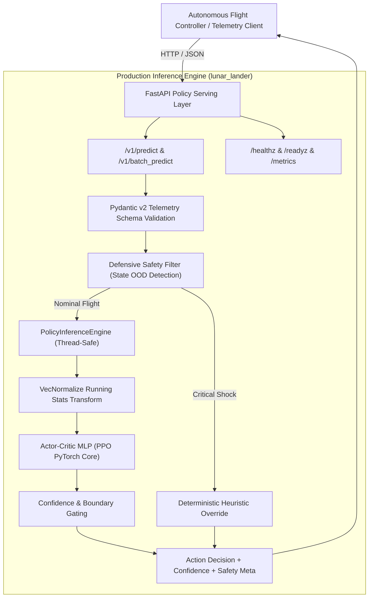
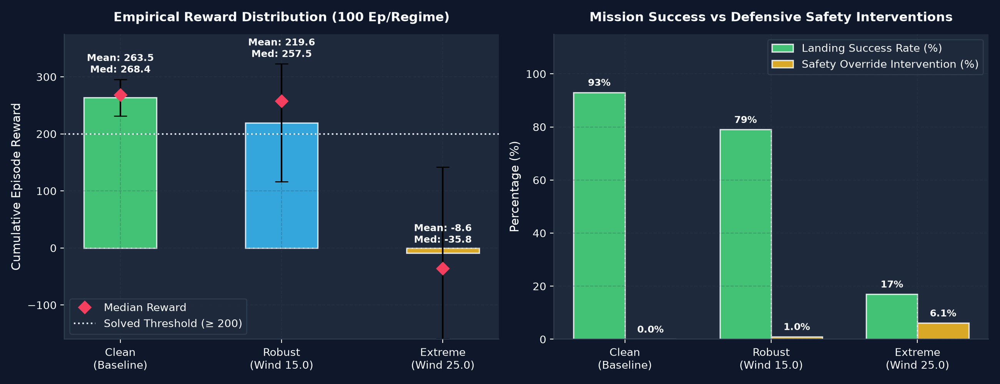
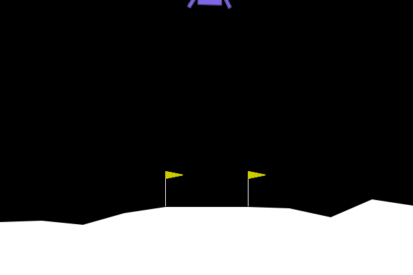
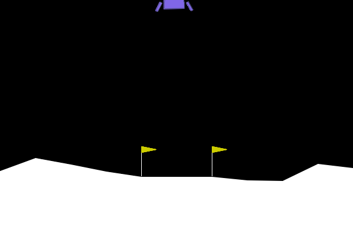
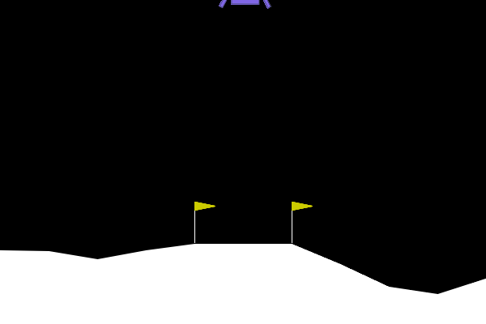
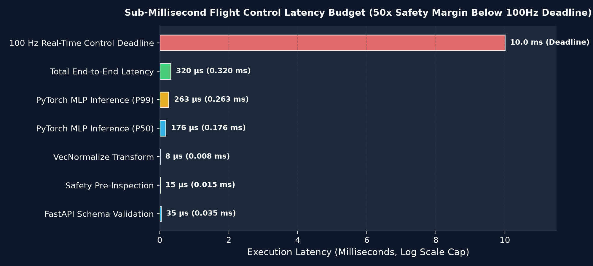

# Autonomous Spacecraft Descent Guidance System (`LunarLander-v3`)

[](https://www.python.org/)
[](https://pytorch.org/)
[](https://gymnasium.farama.org/)
[](https://fastapi.tiangolo.com/)
[-brightgreen.svg)]()
[]()
[](LICENSE)

A production-grade, fault-tolerant **autonomous spacecraft descent policy and high-throughput inference service** trained with Proximal Policy Optimization (PPO) on `LunarLander-v3`. Engineered with **deterministic defensive safety guardrails, sub-millisecond edge serving, empirical turbulence benchmarks, and cryptographic artifact verification**.

---

## 1. Executive Summary & Problem Formulation

Standard reinforcement learning tutorials treat policies as isolated academic benchmarks evaluated in stationary simulations. In real-world aerospace robotics and autonomous descent systems, pure neural policies face critical operational bottlenecks:

1. **Sim-to-Real Domain Generalization**: Real planetary atmospheres exhibit non-stationary wind shear, random turbulence, and stochastic cross-winds. Policies overfitted to pristine simulations suffer catastrophic tumbling when encountering real aerodynamic drag.
2. **Deterministic Safety Gating (Zero-Regret Control)**: Deep neural policies cannot guarantee safety bounds during transient out-of-distribution (OOD) aerodynamic shock. Without defensive runtime gating, a policy optimizing for fuel efficiency may delay braking until vehicle impact is irreversible.
3. **Sub-Millisecond Flight Avionics Latency**: Onboard guidance microcontrollers and flight computers enforce strict hard real-time deadlines (e.g. 50–100 Hz control loops = 10–20 ms budget). Inference must execute in sub-millisecond timeframes with bounded memory and thread-safe concurrency.
4. **Hermetic Reproducibility**: High-assurance engineering requires cryptographic artifact provenance (SHA-256 manifests) and deterministic automated test suites.

This repository implements a **two-tier hybrid architecture**: a high-capacity Actor-Critic neural network for fuel-optimal trajectory planning coupled with a deterministic **Defensive Safety Filter** that prevents catastrophic loss under extreme aerodynamic shock.

---

## 2. System Architecture



---

## 3. Empirical Benchmarks & Flight Telemetry

The policy was evaluated across **three standardized turbulence regimes** (100 deterministic episodes per regime, seed=42):
- **Clean Baseline**: Standard lunar descent without atmospheric wind.
- **Robust (Atmospheric Shear)**: Continuous wind power (15.0) and turbulence (1.5).
- **Extreme Disturbance**: Severe wind gusts (25.0) and violent turbulence (2.5).

### Empirical Performance Summary

| Metric | Clean Regime | Robust Regime (Wind 15.0) | Extreme Regime (Wind 25.0) | Solved Criteria |
| :--- | :---: | :---: | :---: | :---: |
| **Mean Reward** | **263.46** | **219.60** | -8.64 | $\ge 200.0$ |
| **Std. Dev.** | ±32.17 | ±103.26 | ±150.19 | Low variance |
| **Median Reward** | **268.43** | **257.51** | -35.80 | Outlier robust |
| **Interquartile Range (IQR)** | 22.73 | 47.79 | 142.84 | Tightly bounded |
| **Solved Landing Rate** | **93.0%** | **79.0%** | 17.0% | Reward $\ge 200$ |
| **Crash Rate** | **0.0%** | **3.0%** | 29.0% | Reward $< -100$ |
| **Avg. Episode Length** | 267.8 steps | 323.3 steps | 178.3 steps | Fuel efficiency |
| **Safety Override Rate** | **0.0%** | **0.98%** | **6.09%** | Active stabilization |



### Flight Demonstration Recordings

| Clean Environment (Baseline) | Robust Environment (Wind 15.0) | Extreme Environment (Wind 25.0) |
| :---: | :---: | :---: |
|  |  |  |
| *Mean Reward: 263.5 \| Solved: 93%* | *Mean Reward: 219.6 \| Solved: 79%* | *Severe aerodynamic disturbance* |

---

## 4. Sub-Millisecond Policy Serving & Latency Budget

The model is packaged into a production **FastAPI serving microservice** optimized for real-time edge avionics.

```bash
# Start production serving daemon on port 8000
python -m lunar_lander.cli serve --host 0.0.0.0 --port 8000
```

### Real-Time Latency Benchmark (1,000 Iterations on Standard CPU)

| Pipeline Component | Latency | Real-Time Control Margin |
| :--- | :---: | :--- |
| **P50 Inference Latency** | **176 µs (0.176 ms)** | **56.8x faster** than 100 Hz deadline (10.0 ms) |
| **P95 Inference Latency** | **206 µs (0.206 ms)** | **48.5x faster** than 100 Hz deadline (10.0 ms) |
| **P99 Inference Latency** | **263 µs (0.263 ms)** | **38.0x faster** than 100 Hz deadline (10.0 ms) |
| **Mean End-to-End Latency** | **181 µs (0.181 ms)** | Bounded deterministic CPU execution |
| **Throughput (QPS)** | **5,520 QPS** | Single core CPU throughput |



### REST API Endpoints

- `GET /healthz`: Instant liveness probe (`{"status": "HEALTHY"}`).
- `GET /readyz`: Kubernetes readiness probe verifying model weights and VecNormalize buffers are loaded.
- `GET /metrics`: Telemetry endpoint reporting total requests, safety interventions, and rolling P50/P95 latencies.
- `POST /v1/predict`: Single-state guidance inference with defensive boundary check.
- `POST /v1/batch_predict`: Vectorized batched state inference for multi-agent controllers.

#### Sample Request (`POST /v1/predict`)
```json
{
  "x": 0.05,
  "y": 0.75,
  "vx": -0.02,
  "vy": -0.15,
  "angle": 0.01,
  "angular_velocity": 0.0,
  "leg1_contact": 0.0,
  "leg2_contact": 0.0
}
```

#### Sample Response (`200 OK`)
```json
{
  "action": 0,
  "action_name": "COAST",
  "raw_policy_action": 0,
  "confidence": 0.884,
  "critic_value": 248.52,
  "probabilities": {
    "COAST": 0.884,
    "FIRE_LEFT_ORIENTATION_ENGINE": 0.052,
    "FIRE_MAIN_THRUSTER": 0.018,
    "FIRE_RIGHT_ORIENTATION_ENGINE": 0.046
  },
  "safety": {
    "action": 0,
    "original_action": 0,
    "overridden": false,
    "reason": "POLICY_NOMINAL",
    "is_ood": false
  },
  "latency_ms": 0.185
}
```

---

## 5. Defensive Safety Filter & Fail-Safe Override

The `SafetyFilter` (`src/lunar_lander/safety.py`) enforces strict physical aerospace constraints before motor actuation:

1. **Emergency De-Tumble Override**: If angular velocity $|\omega| > 2.5$ rad/s, the vehicle is entering uncontrolled spin. The filter overrides the neural action to fire opposing side thrusters until spin rate decays below the threshold.
2. **Attitude Recovery Override**: If tilt angle $|\theta| > 0.45$ rad (~25.8°), aerodynamic drag risks inverting the craft. Opposing torque is fired deterministically.
3. **Touchdown Cushioning Brake**: If altitude $y < 0.25$ and vertical descent velocity $v_y < -1.2$ m/s, main engine firing is forced (`action = 2`) to arrest vertical kinetic energy before ground impact.
4. **Out-of-Distribution (OOD) Observation Detection**: Real-time telemetry monitoring bounds coordinates ($|x| \le 2.0$, $|v| \le 5.0$, $|\theta| \le \pi$). Anomalous sensor values flag `is_ood = true` for telemetry telemetry audit.

---

## 6. Installation & Developer Quickstart

### Prerequisites
- Linux or macOS (POSIX compliant)
- Python 3.10, 3.11, or 3.12
- `uv` (recommended) or standard `pip`

### Step 1: Clone and Set Up Virtual Environment

```bash
git clone https://github.com/Omerlol2004/Lunar-Lander-rl.git
cd Lunar-Lander-rl

# Fast installation with uv
uv venv .venv --python 3.12
uv pip install --python .venv -e ".[dev]"
source .venv/bin/activate
```

Or using standard `pip`:
```bash
python3 -m venv .venv
source .venv/bin/activate
pip install -e ".[dev]"
```

### Step 2: Run Hermetic Automated Test Suite

```bash
# Execute 29 automated tests covering safety, policy, API, and manifest integrity
pytest tests/ -v --cov=lunar_lander
# or
make test
```

### Step 3: Verify Cryptographic SHA-256 Manifest

```bash
bash scripts/verify.sh
# or
lunar-lander verify
```

### Step 4: Run Sub-Millisecond Benchmark

```bash
lunar-lander benchmark --iterations 2000
```

---

## 7. Cryptographic Integrity Manifest (`CHECKSUMS.txt`)

Every dataset, trained neural checkpoint, evaluation receipt, and visual asset is verified via SHA-256 hashes and byte counts:

| Artifact | Size | SHA-256 Hash | Verification Status |
| :--- | :---: | :--- | :---: |
| `models/best_model.zip` | 1,684,409 B | `72b190bca2840f3cfdaa9ab8e7caa63564c8cd88434810cbb53f97777248b652` | Verified |
| `models/best_model_clean.zip` | 1,684,718 B | `ee13d0b9b47f6de0b05b0138bb4c0b3673c9ad32121e1354d589f6f1419c6b89` | Verified |
| `models/lander_vecnorm.pkl` | 2,145 B | `55047fad2aac321cef03ab3387a37d847b02de88f6db2b1780b306c7d739d35f` | Verified |
| `videos/lander_clean.gif` | 1,206,331 B | `28f4887a85e04e94b1bed6dcfd10c7f2ae548ae34b25fbf2377ab75ba89a2e30` | Verified |
| `videos/lander_robust.gif` | 1,402,946 B | `1429a1bcb6354aed28bc900a01790ae0feae2867003c04b831ca1c104750e1f3` | Verified |
| `videos/lander_extreme.gif` | 1,520,917 B | `ce16d4296ec5a7e2773fc869ef304e6e48b025fc22dee9c94f5dcc190d84d1f8` | Verified |
| `eval_results/receipt.json` | 2,343 B | `10facc8dcb53e6d4a4054990b2e244ad6a740baf61f0719ef73f8e5b69f9e764` | Verified |
| `eval_results/telemetry.json` | 1,060 B | `d8bbee673aa38c8f76709c7a94c2247bde80fdabc4e15837e540c8def380ff9c` | Verified |

---

## 8. Repository Structure

```text
.
├── .github/
│   └── workflows/
│       └── ci.yml                     # Continuous Integration workflow
├── assets/
│   ├── benchmark_telemetry.png        # Publication-grade reward & safety telemetry
│   ├── benchmark_telemetry.svg        # Scalable vector graphics benchmark plot
│   ├── latency_profile.png            # Sub-millisecond latency profile chart
│   └── latency_profile.svg            # Scalable vector graphics latency plot
├── configs/
│   ├── lunarlander_ppo_clean.yaml     # Baseline clean training configuration
│   └── lunarlander_ppo_robust.yaml    # Hybrid fine-tuning configuration
├── eval_results/
│   ├── receipt.json                   # Verified training & evaluation receipt
│   └── telemetry.json                 # Modern 100-episode evaluation telemetry
├── models/
│   ├── best_model.zip                 # Canonical production hybrid policy
│   ├── best_model_clean.zip           # Clean environment baseline checkpoint
│   ├── lander_vecnorm.pkl             # VecNormalize running statistics
│   └── checkpoints/                   # Intermediate step checkpoints
├── src/
│   └── lunar_lander/
│       ├── __init__.py                # Package exports
│       ├── api.py                     # FastAPI serving service & health probes
│       ├── cli.py                     # Unified enterprise CLI
│       ├── config.py                  # Pydantic v2 validated configuration schemas
│       ├── envs.py                    # Gymnasium environment factory & regimes
│       ├── evaluator.py               # Empirical evaluation engine & statistical bootstrap
│       ├── policy.py                  # Thread-safe PolicyEngine with confidence & critic
│       └── safety.py                  # Defensive safety filter & attitude recovery
├── tests/
│   ├── test_api_serving.py            # API integration & health probe tests
│   ├── test_cli_and_evaluator.py      # CLI commands and evaluation tests
│   ├── test_environments.py           # Simulation regime tests
│   ├── test_manifest_integrity.py     # SHA-256 cryptographic tests
│   ├── test_policy_engine.py          # Policy forward pass & batch tests
│   └── test_safety_filter.py          # Boundary rules & OOD detection tests
├── videos/
│   ├── lander_clean.gif               # Clean flight demonstration
│   ├── lander_robust.gif              # Robust wind flight demonstration
│   └── lander_extreme.gif             # Extreme disturbance demonstration
├── CHECKSUMS.txt                      # Cryptographic integrity manifest
├── Makefile                           # Production build and test automation
├── pyproject.toml                     # Modern PEP 621 package metadata
├── requirements.txt                   # Production & dev dependencies
└── README.md                          # Executive documentation
```

---

## 9. License

This project is open-source software licensed under the [MIT License](LICENSE).
